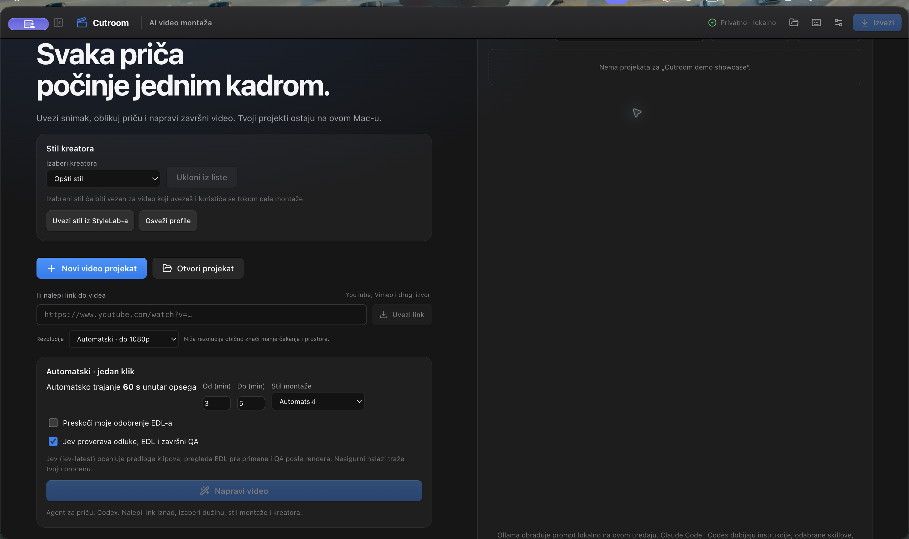
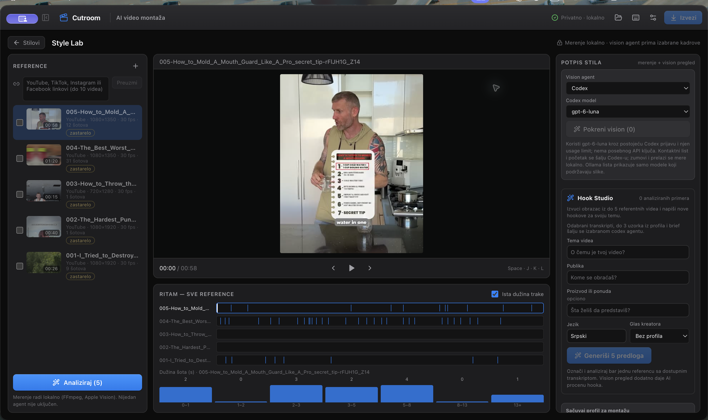
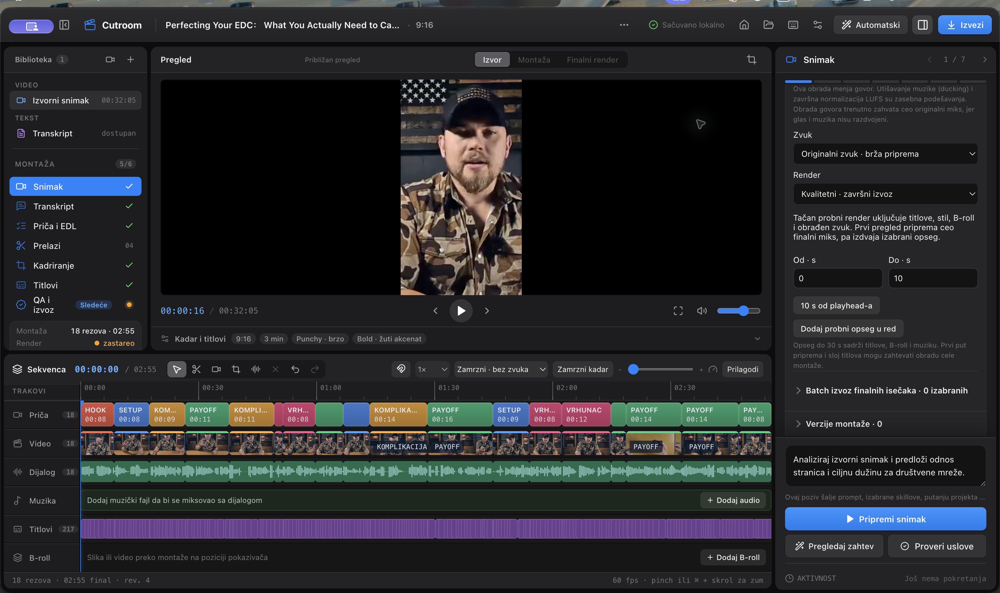
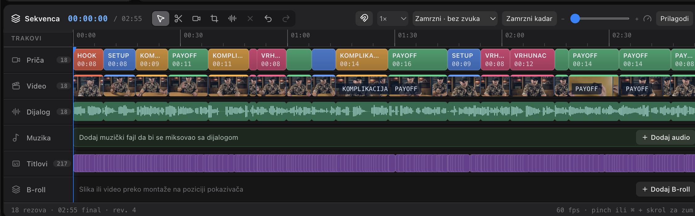

# Cutroom

**Turn long recordings into polished short-form videos—with AI assistance and the editor in control.**

Cutroom is a macOS video-editing workspace for creators. Bring in a recording, shape its story, refine the cut on a multitrack timeline, and prepare a finished video for social platforms.

AI can help organize a story and suggest an edit decision list (EDL). You review and approve those decisions, then refine the result using the transcript, framing tools, captions, titles, music, and B-roll. A final quality check helps catch issues before export.

The interface is available in **English and Serbian**. Projects stay on your Mac. Local Ollama processing stays on-device; when you choose an online provider, the context needed for that request is sent according to that provider's settings.

## Screenshots

### Start a project

Choose a creator style, open a local project, or start from a video link. The home screen brings the main workflows together.

### Study references in Style Lab

Review reference videos, compare their pacing, and develop hook ideas for a topic and audience.

### Edit on a multitrack timeline

Review the source, story, transcript, framing, captions, and export checks in one editing workspace.

### Timeline detail

Story segments, video and dialogue tracks, music, captions, and B-roll lanes work together in the edit.

## What Cutroom does

- **Shapes a story from long footage:** AI-assisted story and EDL proposals give you a starting point, with review and approval in your hands.
- **Studies editing references:** Style Lab compares pacing across selected videos; Hook Studio helps draft original hooks for your topic and audience.
- **Connects transcript and timeline editing:** Refine cuts from the transcript, then arrange and adjust story segments on the timeline with undo and redo.
- **Builds social-ready edits:** Adjust framing and aspect ratios, add captions and titles, and work with music and B-roll.
- **Checks the final export:** Review render quality, including audio levels, black frames, silence, and timing.
- **Keeps work local by default:** Projects and media are stored on your Mac.

## O Cutroom-u

Cutroom je macOS radni prostor za video montažu koji pomaže kreatorima da od dugog snimka naprave jasno strukturisan video za društvene mreže.

AI može da predloži strukturu priče i EDL — listu odluka za montažu — a ti pregledaš predloge i odobravaš izmene. Zatim možeš da uređuješ transkript i kadrove na vremenskoj liniji, prilagodiš kadriranje, dodaš titlove, naslove, muziku i B-roll, pa proveriš završni izvoz.

Style Lab pomaže u analizi ritma referentnih snimaka, a Hook Studio u osmišljavanju uvodnih rečenica za određenu temu i publiku. Interfejs je dostupan na srpskom i engleskom. Projekti i mediji čuvaju se lokalno na Mac-u.

## About this repository

Cutroom is proprietary software. This public repository is a product showcase containing descriptions and screenshots only. It does **not** contain application source code, build files, binaries, project media, or secrets.
